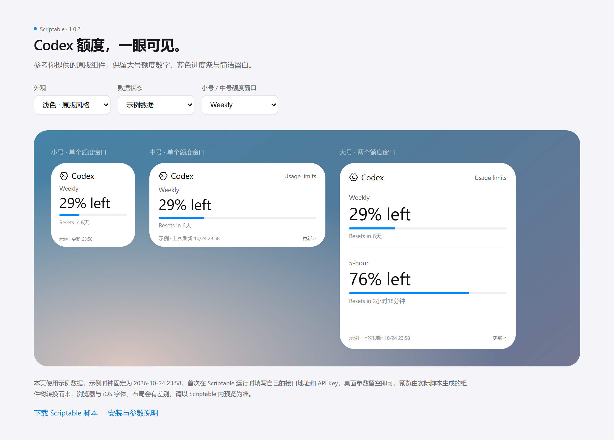
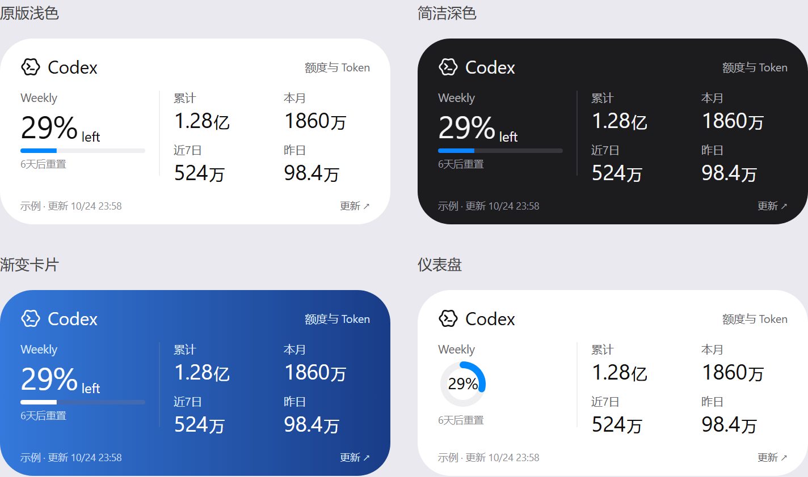

# Codex Usage · Scriptable 小组件与本地 API

在 iPhone 桌面查看 Codex 账号额度和 Token 用量。仓库同时包含 **Scriptable 小组件**和配套的 **Node.js 本地 API**：电脑读取当前登录账号的数据，手机通过自己的服务地址读取并展示。小组件版本 **1.0.8**，采用「综合概览」布局，支持小号、中号、大号，以及四种可选外观。

[查看脚本](https://github.com/awesomehy/scriptable-codex-usage/blob/main/CodexUsage.js) · [下载源码](https://raw.githubusercontent.com/awesomehy/scriptable-codex-usage/main/CodexUsage.js)

## 项目结构

```text
CodexUsage.js             iPhone / Scriptable 小组件
update.json              小组件更新清单与源码校验值
server/                  配套额度 API，无第三方 npm 依赖
  config.example.json    通用配置模板，不含私人地址或密钥
  src/                   HTTP 服务与 Codex 读取逻辑
  scripts/               Windows 后台启停与任务栏状态图标脚本
  test/                  API 与 Codex 通信测试
tests/                   小组件及前后端数据契约测试
scripts/                 小组件预览、更新清单生成脚本
```

数据流：**电脑上已登录的 Codex → 本地 API → Scriptable → iOS 桌面小组件**。小组件展示当前账号共享额度，以及累计、本月、近 7 日和昨日的账号级 Token 汇总；这些用量不按电脑或项目拆分。服务只查询数据，不发起模型对话。

## 1. 部署配套 API

需要 Node.js **22 或以上**，以及已通过 ChatGPT 登录、能够联网的 Codex。Windows 提供后台启停脚本和任务栏通知区域状态图标；其他系统可以直接使用 Node.js 前台运行，具体 Codex 安装和登录以本机环境为准。

```powershell
git clone https://github.com/awesomehy/scriptable-codex-usage.git
cd scriptable-codex-usage\server
Copy-Item config.example.json config.json
node -e "console.log(require('node:crypto').randomBytes(32).toString('hex'))"
```

最后一条命令生成供本服务使用的随机 Key。编辑刚创建的 `server/config.json`：将 `host` 改为 `0.0.0.0`，将 `apiKey` 设为生成的值（至少 **24 个字符**），端口默认 `58321`。保留其他字段。不要用 Codex 登录令牌作为 API Key，也不要把个人配置提交到 GitHub。

Windows 安装任务栏监控并启动服务：

```powershell
powershell -NoProfile -ExecutionPolicy Bypass -File .\scripts\install-tray.ps1
```

从服务端本机测试，Key 自动读取自配置：

```powershell
$config = Get-Content -Raw .\config.json | ConvertFrom-Json
Invoke-RestMethod 'http://localhost:58321/health'
Invoke-RestMethod 'http://localhost:58321/api/usage' -Headers @{
    Authorization = "Bearer $($config.apiKey)"
}
Invoke-RestMethod 'http://localhost:58321/api/token-usage' -Headers @{
    Authorization = "Bearer $($config.apiKey)"
}
```

小组件所在的手机需要能访问这台电脑。局域网内使用电脑的局域网地址；跨网络时配置你自己的域名、路由器 TCP 端口转发及防火墙，并为公网入口配置 HTTPS。`localhost` 在手机上指手机本身，不能作为电脑的访问地址。

手机中填写的完整接口地址类似 `https://codex-api.example.com/api/usage`，该地址仅为占位示例，仓库不提供公共额度服务。域名、端口和协议应替换为自己的部署值。浏览器直接访问额度接口缺少 Bearer 请求头时会返回 `401`，可先访问 `/health` 检查连通性。

Token 用量接口 `GET /api/token-usage` 返回 `lifetimeTokens`、`thisMonth`、`last7Days`、`yesterday`；日期缺失时周期合计标记为不完整。详细配置、接口字段、调用示例和排错见 **[API 部署与使用文档](server/README.md)**。Windows 计划任务在登录后独立启动监控和 API；也可双击桌面的 **Codex Usage API Monitor**，或通过监控图标右键启停 API、开启或关闭保活。电脑需保持开机且服务运行。

## 2. 安装或升级 Scriptable 小组件

1. 复制同目录 `CodexUsage.js` 的全部内容。
2. 在 iPhone 的 Scriptable 中新建 **CodexUsage**；如果已经安装，打开原脚本，替换全部内容并保存。
3. 运行脚本。首次运行会弹出设置框，填写自己的额度接口完整地址和 API Key，点击 **保存并刷新**。代码不预置任何私人服务地址或密钥。
4. 在 iOS 桌面添加 Scriptable 小组件，选择所需尺寸。在“编辑小组件”中将 Script 设为 **CodexUsage**，Parameter 留空。
5. 如果之前填过 `{"scenario":"demo"}` 等预览参数，请清空，或将 `scenario` 改成 `live`。

接口地址和 API Key 一起保存到本机 [Scriptable Keychain](https://docs.scriptable.app/keychain/)，不写入脚本、组件参数、预览页面或额度缓存。以后替换脚本代码时，已保存的连接设置会保留。HTTP 不加密传输；接口支持时请使用 HTTPS。

Parameter 留空时，点击桌面组件会打开脚本菜单，可预览三个尺寸、**立即刷新**、修改接口 / API Key、设置刷新间隔或选择小号 Token 显示项。保存连接设置后会读取一次真实额度和 Token 用量，并显示中号预览。

## 综合概览

| 尺寸 | 显示内容 |
| --- | --- |
| 小号 | 一个额度窗口、进度条或圆环、重置倒计时，以及一项可选 Token 用量 |
| 中号 | 左侧额度，右侧 2×2 排列累计、本月、近 7 日和昨日 Token 用量 |
| 大号 | 顶部最多两个实际存在的额度窗口，下方 2×2 排列四项 Token 用量 |

在 Scriptable 运行 **CodexUsage → 小号 Token（当前选项）**，可选 **累计 / 本月 / 近 7 日 / 昨日**，默认 **本月**。选择后立即显示小号预览。该选择保存在本机，对所有小号组件生效，更新代码后保留；不需要填写 Parameter。

Token 数字使用中文 **万、亿**，单位以较小字号紧随数字：`984000` 显示为 `98.4万`，`128400000` 显示为 `1.28亿`。整数位数增多时自动减少小数：亿的整数部分为一位时最多两位小数、两位时最多一位、三位及以上不显示小数，例如 `65.68亿 → 65.7亿`、`100.91亿 → 101亿`。万最多保留一位小数，整数三位及以上不显示小数；不足一万显示整数，未知值显示 `—`。极大数字仍保留完整整数，并在空间不足时适当缩小数字。周期用量仅合计接口已返回日期，组件不额外显示星号或缺失日期说明。

额度与用量共用底部一个更新时间。两类数据均成功读取过时取较早的 API `fetchedAt`，避免新额度掩盖较旧的用量；其中一个接口失败时保留可用数据，并标注状态。



## 外观布局

在 Scriptable 运行 **CodexUsage → 外观布局 → 选择风格**，保存后显示预览。设置保存在本机 Keychain，所有尺寸共用，更新或恢复代码都不会清除，也不会改变接口、密钥和刷新秒数。

| 布局 | `layout` 参数 | 外观 |
| --- | --- | --- |
| 原版浅色 | `original` | 默认白底蓝条，兼容已有 `theme` 设置 |
| 简洁深色 | `dark` | 固定深色背景，蓝色进度条 |
| 渐变卡片 | `gradient` | 蓝色渐变背景，白色文字及进度条 |
| 仪表盘 | `dashboard` | 圆环展示剩余额度，兼容 `theme` 设置 |



四种外观均采用综合概览的内容安排，保留真实数据时间、错误状态和更新入口。默认继续使用原版。桌面组件会在 iOS 下次运行脚本时采用本地选择；保存后的应用内预览立即生效。

需要同一桌面使用不同布局时，在各组件 Parameter 的 JSON 中设置 `layout`，优先于本地选择。例如以下参数选择仪表盘并在点击时打开 ChatGPT：

```json
{"layout":"dashboard","openURL":"chatgpt://"}
```

原来直接填写的 `chatgpt://` 仍可使用，会采用本地选择的布局。已有 JSON 参数只需增加 `layout` 字段，移除此字段即可恢复跟随本地选择。完整预览见 [preview.html](preview.html)，浏览器排版与 iOS 存在差异，请以设备预览为准。

## 一键更新

运行脚本 → **一键更新脚本**，或点击中号、大号组件右下角的 **更新 ↗**。

更新从本公开仓库 `main` 分支获取，清单与源码锁定同一个提交，并校验 SHA-256、脚本标识、版本和语法。先备份当前代码，再写入并回读校验；不使用文件移动替换。失败时尝试恢复原脚本，菜单提供 **恢复更新前版本**。

更新成功后重新运行新版脚本，自动强制读取一次额度和 Token 用量并显示预览，每个接口各请求一次。接口地址、密钥、本机刷新间隔、外观、小号显示项和桌面参数保留。桌面组件的实际重绘时机仍由 iOS 控制。更新只请求 GitHub 公共资源，不向 GitHub 发送额度接口凭据；无法访问 GitHub 时可手动复制完整源码覆盖原脚本。

仓库只发布代码、通用配置模板、测试样例、发布清单和示例预览。服务端个人配置保存在被 Git 忽略的 `server/config.json`；手机连接设置保存在 Scriptable Keychain。小组件的一键更新只更新 `CodexUsage.js`，服务端需要单独更新并重启。

## 显示和刷新

- 小号、中号：默认优先展示周额度；没有周额度时展示该额度组实际返回的第一个窗口。
- 大号：最多显示两个实际存在的窗口；只有周额度时只显示一组。每组显示剩余比例和重置倒计时，下方显示四项 Token 用量。
- `primary` / `secondary` 不代表固定周期，实际按 `windowDurationMins` 识别。10080 分钟显示 Weekly，300 分钟显示 5-hour。
- 底部“更新”使用 API 的 **`fetchedAt`**，时间统一为北京时间；两类数据均有成功时间时取较早值。读取旧缓存不会将其改成手机当前时间。
- 刷新间隔默认 **600 秒（10 分钟）**，可在脚本菜单本地配置。本地数据和服务端数据时间都在该间隔内时复用本地缓存；数据超过“30 分钟或三个刷新间隔中的较大值”时标记“已过期”。
- “立即刷新”跳过本地缓存，分别调用 `/api/usage?refresh=1` 和 `/api/token-usage?refresh=1`，让服务端重新读取额度及用量；服务端限流时仍遵守 `Retry-After`。普通刷新最多请求两个接口，命中本地缓存或处于冷却期的接口不请求。
- 失败时保留上次成功数据和时间，按原因标注“连接失败”“请求超时”“域名异常”“服务异常”或“验证失败”等；没有旧数据时显示 `—` 和错误说明。“连接失败”时请检查接口服务是否已启动、端口是否可访问。未知额度也显示 `—`，不会转换成 0%。
- 重置时刻已到但还没有新数据时，提示等待刷新，不自行改成 100%。
- 重置倒计时：剩余至少 24 小时时，天数四舍五入（6 天 4 小时显示 6 天，6 天 12 小时显示 7 天）；不足 24 小时显示“X 小时 Y 分钟”，分钟也按最近整数舍入，小号同样保留分钟。是否已到重置时间按实际时间判断，不由舍入值判断。
- 本月、近 7 日和昨日的日期范围采用 API 返回值，由服务端所在时区决定。累计是账号累计 Token；周期合计缺少日期时不会按零补齐，也不会用累计值推算。

### 本机刷新间隔

在 Scriptable 内运行 **CodexUsage** → **刷新间隔（当前秒数）** → 输入整数秒 → **保存并刷新**。支持 **1–86400 秒**，例如 `30` 表示 30 秒，`600` 表示 10 分钟；默认 600 秒。保存后会立即强制查询一次额度和 Token 用量。

间隔保存在本机 Scriptable Keychain，对同一手机上的所有尺寸生效，更新或恢复脚本后保留。Parameter 仍可直接填写 `chatgpt://`，无需加入刷新设置。从旧版升级后，原 Parameter 中的 `refreshMinutes` 不再生效，请改在脚本菜单设置。

根据 [Scriptable 刷新说明](https://docs.scriptable.app/listwidget/#refreshafterdate)，这里设置的是申请的最早运行间隔，实际由 iOS 调度；填写 1 秒不能保证桌面每秒更新。脚本内刷新并展示预览后，桌面组件仍由 iOS 安排重绘，不能保证立刻变化。

## 参数

桌面组件的 Parameter 可以直接填写应用跳转链接（如 `chatgpt://`），也接受 JSON，例如：

```json
{"theme":"dark","window":"weekly"}
```

| 字段 | 默认值 | 说明 |
| --- | --- | --- |
| `theme` | `light` | `light` / `dark` / `auto` |
| `layout` | 本机菜单选择，初始 `original` | `original` / `dark` / `gradient` / `dashboard`；显式填写时优先于本机选择 |
| `window` | `auto` | `auto` / `weekly` / `session` / `primary` / `secondary`；仅影响小号、中号 |
| `limitId` | `codex` | 精确选择 `limits` 中的额度组，不混用其他模型额度 |
| `scenario` | `live` | `live` 为真实数据；`demo` / `stale` / `empty` / `error` 用于不联网的界面预览 |
| `openURL` | 空字符串 | 点击组件时打开的链接；留空打开脚本菜单 |

### 点击打开 App

先在 Scriptable 内运行脚本 → **一键更新脚本**，升级到 v1.0.2 或更新版本。然后长按桌面组件 → 编辑小组件，在 **Parameter** 直接填写目标 App 支持的完整 URL Scheme，例如 `chatgpt://`（不用引号）。脚本将链接交给 iOS 打开，不按 App 名称做映射。也可使用 JSON 与其他参数组合：

```json
{"openURL":"chatgpt://","theme":"light"}
```

“When Interacting” 可以保留 Open App。脚本设置的点击链接会优先于该选项，见 [Scriptable 的 url 说明](https://docs.scriptable.app/listwidget/#url)。点击主体打开填写的链接；中号、大号右下角的更新链接仍打开脚本更新。小号需要从 Scriptable App 内运行脚本来修改配置或更新。

需要 iPhone 已安装相应 App，且该 App 支持填写的 URL Scheme；实际唤起行为需在 iPhone 上确认。链接中的路径、查询参数及片段会保留，空格请写成 `%20`。也可填写 `https://` 网页链接，由 iOS 决定打开网页或关联 App。Parameter 留空时打开脚本菜单。

从 v1.0.1 升级时，请把原来的纯名称 `ChatGPT` 改为 `chatgpt://`；使用 JSON 时，将 `tapAction` 改为 `openURL` 并填写完整链接。新版不再识别 App 名称或 `tapAction`。

`session` 选择实际存在的、短于一周的最短周期，不会虚构缺失的窗口。显式选择的周期不存在时显示“此额度窗口暂无数据”。演示场景会标注“示例”，日期固定为 2026-10-24，不能当作实时额度。不要在 Parameter 中填写 API Key 或接口地址；在脚本设置菜单中管理它们。

## API 适配与缓存

两个接口均使用 `Authorization: Bearer <API Key>`。在本机只需保存一个完整的额度接口地址；脚本将其末尾的 `/usage` 替换为 `/token-usage`，沿用协议、域名、端口、路径前缀和同一个 Key，无需额外配置。请求超时设为 20 秒；拒绝重定向，以免凭据被转发到其他地址。更换地址时需要重新输入密钥。服务端也需更新到包含 Token 接口的版本并重启；旧服务端没有该接口时仍可显示额度，用量显示 `—` 和未更新状态。

适配字段包括 `ok`、`fetchedAt`、`limits[].limitId`、两类窗口的 `remainingPercent` / `usedPercent`、`windowDurationMins`、`resetsAtIso` / Unix 秒级 `resetsAt`，以及是否允许使用、消费限制、可用重置次数等状态。缺少剩余比例而提供已用比例时，按 `100 - usedPercent` 计算并限制到 0–100。

本地缓存位于 Scriptable 本机文档目录 `CodexUsageWidget`。额度与 Token 用量分别保存，各有两份文件交替写入并读回校验，不依赖 iCloud 同步或文件移动。新文件损坏时可回退到另一份有效文件。密钥或接口改变会切换缓存分区，避免显示另一连接的旧数据。升级可继续读取旧版额度缓存。

“未保存”表示当次网络数据可显示，但没有成功保存到本地供下次离线使用。一般请求失败后冷却 60 秒，手动刷新可跳过此冷却；429 限流则遵守服务端给出的重试时间。

## 开发验证

Node.js 22+，无 npm 依赖，无需执行 `npm install`。在仓库根目录执行：

```sh
npm test
npm run test:server
npm run preview
npm run check:release
node --check CodexUsage.js
```

`npm test` 同时运行小组件和 API 测试；`npm run test:widget` / `npm run test:server` 可分别运行。自动测试覆盖本机设置及升级保留、双接口鉴权和独立缓存、合并更新时间、Token 中文单位与缺失日期、窗口映射、强制刷新、未知值、连接失败、超时、格式错误、重定向、限流、凭据切换、缓存写入失败和 API 响应与小组件的兼容性。测试使用模拟响应，无需 Codex 登录或真实密钥。

发布新版本时，修改脚本顶部版本标记和 `VERSION`，运行 `npm run release` 生成 `update.json`，将源码与清单在同一提交中推送。不要将个人配置文件加入仓库。

`preview.html` 是由实际渲染函数生成的交互式界面预览，使用明确标注的示例数据，不访问接口。浏览器的字体和布局与 iOS 会有差异，最终显示需要在 iPhone 的 Scriptable 中确认。

## 隐私与故障排查

**有剩余额度但进度条偶尔全灰**：v1.0.5 将进度条前景从硬切换渐变改为运行时预先绘制的本地图像，灰色底轨继续跟随主题。数字和图像使用同一个剩余百分比，不增加网络请求。此变更绕开旧版渐变绘制路径；iOS 桌面快照的间歇性表现仍需在设备上确认。运行脚本 → 一键更新脚本，更新后会重新读取数据并预览；桌面画面在 iOS 下次重绘时替换。

个人 API Key、服务地址、内网 IP 和本机安装路径应只写入私有配置。`.gitignore` 已排除 `config.json`、`.env*`、`.runtime/`、日志、密钥文件和依赖目录；配置模板中的回环地址和文档中的 `example.com` 地址是通用示例。

| 现象 | 处理 |
| --- | --- |
| 手机连接超时 | 先用手机访问自己部署的 `/health`，检查电脑是否开机、服务是否运行、网络地址和端口转发是否正确。 |
| `401` / 验证失败 | 核对手机设置中的 API Key；更换服务端 Key 后重启服务，并更新手机保存的 Key。 |
| `502` / `503` / `504` | 查看 API 返回的错误码和服务端日志，检查 Codex 登录、可执行文件和联网状态。 |
| 小组件仍显示旧数据 | 在脚本菜单选择“立即刷新”，核对 API 的 `fetchedAt`；iOS 桌面实际重绘由系统调度。 |
| 修改 Key 后未生效 | 重启 API；检查服务端环境变量 `CODEX_USAGE_API_KEY` 是否覆盖了配置文件。 |

HTTP 会明文传输 Key 和额度数据，公网部署应使用 HTTPS。不要将带真实凭据的配置、日志或截图加入仓库。
